# Language Modeling from Scratch — Technical Report

<!--
HOW TO USE THIS FILE
Prose is yours to write; the data tables and figures are generated.

  bash run_experiments.sh                                        # everything
  STAGES="feasibility systems" bash run_experiments.sh            # selected stages
  STAGES=list bash run_experiments.sh                            # stage names
  uv run python scripts/make_plots.py                            # rebuild figures
  uv run python scripts/make_plots.py --tables                    # reprint every data table

Every number comes from checkpoints/<run>/{config.json,metrics.jsonl,summary.json}.
Regenerate, do not hand-edit.

TWO CONVENTIONS TO STATE ONCE AND THEN RELY ON:
  - "Final validation loss" = last scheduled eval, averaged over 20 fixed
    validation batches. Always the final value, never the minimum.
  - Cross-tokenizer comparisons use bits per byte, never raw cross-entropy.

SECTION ORDER IS DELIBERATE: the hardware section (4) comes before the experiments
(5, 6) because the optimizations were a precondition for running the full suite.
Every run in sections 5 onward uses --mixed_precision --compile --async_io.
-->

## 1. Scope

<!--
Four or five sentences:
  - What was built from scratch: BPE tokenizer, Transformer LM, AdamW, cosine
    schedule, training loop, checkpointing, decoding.
  - The constraint that shaped the project. Be precise, because the probes settled
    it: the recommended configuration DOES fit in FP32 on an 11 GB RTX 2080 Ti.
    What FP32 could not do is finish in reasonable time: 38-40k tokens/s against
    121-134k for the optimized stack. So the systems work was forced by a
    throughput ceiling, and the 32-48% memory saving is what bought headroom at
    the larger batch sizes.
  - What was measured: feasibility probes across batch sizes to the point of
    failure, a six-stage optimization ladder, three TinyStories sweeps at 40.96M
    tokens, an LR transfer test plus a wider bracket on OpenWebText, full runs at
    327.68M tokens, and doubled-budget runs at 655.36M.
  - Headline results: TinyStories 1.2527 (ppl 3.50), OpenWebText 3.7631 (ppl
    43.08), both at 655.36M tokens; 3.30x step-time speedup at unchanged loss.
  - What this is not: no scaling-law study, no architecture ablations, no
    leaderboard attempt (weight tying and init are named in section 9).
-->

## 2. Implementation

| Component | File | Design note |
|---|---|---|
| BPE tokenizer | `cs336_basics/train_bpe.py`, `tokenizer.py` | |
| Transformer LM | `cs336_basics/transformer_lm.py`, `transformer_block.py` | |
| Attention + RoPE | `cs336_basics/multihead_self_attention.py`, `rope.py` | |
| AdamW / LR schedule | `cs336_basics/adamw.py`, `learning_rate_schedule.py` | |
| Data loading | `cs336_basics/data_loading.py` | |
| Checkpointing / logging | `cs336_basics/checkpointing.py`, `training_together.py` | |
| Decoding | `cs336_basics/decoding.py` | temperature + top-p, sliding 256-token window |

<!--
One line per component: the file, and the single design decision worth knowing.
Worth calling out:
  - pre-norm RMSNorm blocks, SwiGLU FFN, RoPE applied per block.
  - UNTIED input embedding and output projection. This matters twice later: it is
    why vocabulary size dominates cost (section 6.2) and it is the first thing
    future work would change (section 9).
  - memmapped uint16 token stream, random spans, DataLoader workers.
  - JSONL metrics stream, checkpoint rotation, optional background writer thread.
    Section 4.2 measures the writer thread rather than assuming it helps, and the
    result is not the one you would expect.
  - Decoding conditions on a sliding window of the last context_length tokens.
    Worth one sentence: RoPE precomputes tables for exactly context_length
    positions, so generating past 256 tokens requires the window, and beyond that
    point the model can no longer see the start of its own output. That is a
    property of a 256-context model, and it is visible in the OpenWebText sample
    as topic drift.
  - AdamW written from scratch with decoupled weight decay; gradient clipping by
    global L2 norm; the LR is set before each optimizer step.
-->

## 3. Experimental Protocol

| Setting                | Value                                                                 |
| ------------------------| -----------------------------------------------------------------------|
| GPU                    | NVIDIA GeForce RTX 2080 Ti, 11264 MiB, Turing                         |
| Software               | driver 550.127.05, CUDA 12.4, PyTorch 2.6.0, Python 3.12              |
| Model                  | 4 layers, d_model 512, 16 heads, d_ff 1344, RoPE theta 10000          |
| Parameters             | 22.7M (vocab 10k) / 45.2M (vocab 32k), untied embeddings              |
| TinyStories tokenizer  | BPE, vocab 10000                                                      |
| OpenWebText tokenizer  | BPE, vocab 32000                                                      |
| Short-run token budget | 40,960,000                                                           |
| Full-run token budget  | 327,680,000                                                          |
| Extended token budget  | 655,360,000                                                          |
| Optimizer              | AdamW, betas (0.9, 0.999), eps 1e-8, weight decay 0.05, grad clip 1.0 |
| Schedule               | linear warmup (5% of steps) then cosine to 1e-5                       |
| Mixed precision        | FP16 autocast with gradient scaler (Turing has no bf16)               |
| Evaluation             | 20 fixed validation batches, every 250 steps                          |
| Seed                   | 42 (all runs)                                                         |
| Replicate spread       | 0.0019 val loss across three identical configs                        |

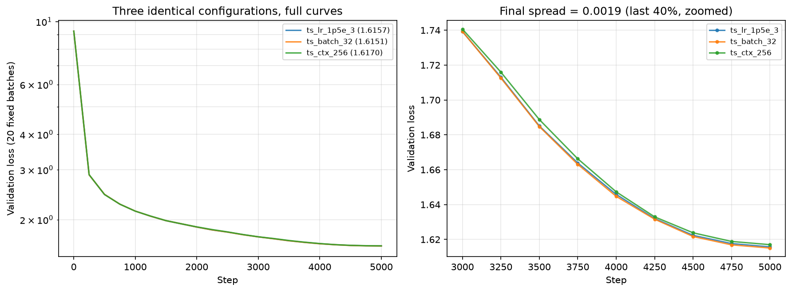

<!--
Four things to be explicit about:

1. The token budget is the control variable. Steps are derived as
   tokens / (batch x context), so a batch sweep deliberately changes the number of
   optimizer updates. Say it out loud: it is what section 5.2 measures and what
   section 6.3 ends up explaining.

2. The measurement floor. ts_lr_1p5e_3, ts_batch_32 and ts_ctx_256 are the same
   configuration by construction (bs32, ctx256, 5000 steps, lr 1.5e-3, seed 42)
   and finished at 1.6157 / 1.6151 / 1.6170, so run-to-run nondeterminism is
   +/-0.002 val loss. Refer back to this whenever you claim a difference is real;
   everything interpreted later is at least 10x larger. The residual comes from
   nondeterministic CUDA kernels and DataLoader worker interleaving, not seeding.

3. GPU contention, and how it was handled. The machine is a shared three-GPU
   desktop, and part of the suite ran while two other processes were resident.
   Affected runs are ~1.30x slower in absolute throughput. Section 9 lists them
   and quantifies it. State here that losses are unaffected and that throughput
   is only compared within a section, never across.

4. Mixed precision here means FP16, not bf16, because Turing predates bf16 support.
   That is why a gradient scaler is required, and section 4.3 checks it did no harm.
-->

## 4. Training Under Hardware Constraints

<!--
FRAMING, and this is the part to get right: this section is not an optional
ablation. You set out to train the recommended configuration on an 11 GB
consumer GPU, hit a wall, investigated a way around it, implemented it, confirmed
it worked, and only then checked what it cost in quality. The ablation is a
by-product of the workaround. Say that in two sentences and move on.

Be accurate about which wall, though: 4.1 shows the wall is throughput, with
memory as a secondary constraint that binds only at larger batch sizes.
-->

### 4.1 The constraint

| Dataset | Vocabulary | Batch | Precision / stack | Outcome | Peak VRAM | Tokens/s |
| --- | ---: | ---: | --- | --- | ---: | ---: |
| TinyStories | 10000 | 32 | eager FP32 | fits | 4400 MB | 49,779 |
| TinyStories | 10000 | 32 | AMP + compile + async | fits | 2974 MB | 162,056 |
| TinyStories | 10000 | 64 | eager FP32 | fits | 8523 MB | 50,638 |
| TinyStories | 10000 | 64 | AMP + compile + async | fits | 5639 MB | 179,109 |
| TinyStories | 10000 | 96 | eager FP32 | **OOM** | — | — |
| TinyStories | 10000 | 96 | AMP + compile + async | fits | 8303 MB | 187,638 |
| TinyStories | 10000 | 128 | eager FP32 | **OOM** | — | — |
| TinyStories | 10000 | 128 | AMP + compile + async | **OOM** | — | — |
| OpenWebText | 32000 | 16 | eager FP32 | fits | 4315 MB | 32,729 |
| OpenWebText | 32000 | 16 | AMP + compile + async | fits | 3648 MB | 77,792 |
| OpenWebText | 32000 | 32 | eager FP32 | fits | 8095 MB | 34,852 |
| OpenWebText | 32000 | 32 | AMP + compile + async | fits | 6707 MB | 91,281 |
| OpenWebText | 32000 | 48 | eager FP32 | **OOM** | — | — |
| OpenWebText | 32000 | 48 | AMP + compile + async | fits | 9766 MB | 97,884 |
| OpenWebText | 32000 | 64 | eager FP32 | **OOM** | — | — |
| OpenWebText | 32000 | 64 | AMP + compile + async | **OOM** | — | — |

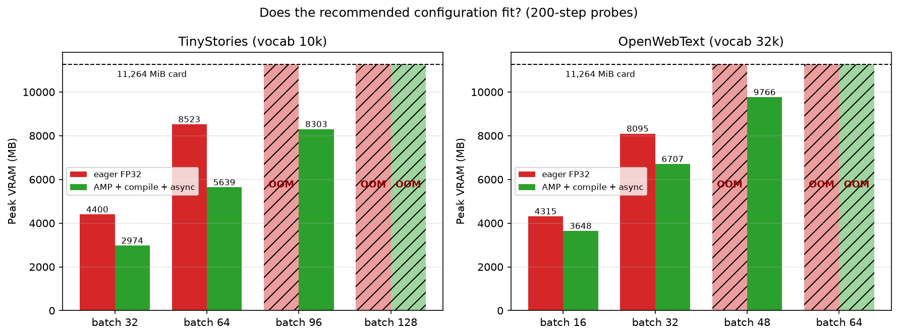

<!--
There are two constraints here and the probes separate them, so make both claims
and keep them distinct.

First, the memory wall, which is real and now located. Sweeping batch past the
point of failure gives a clean answer: FP32 dies between 64 and 96 on TinyStories
and between 32 and 48 on OpenWebText, while the optimized stack reaches 96 and 48
respectively and dies one rung later. So the optimizations bought **exactly one
doubling-ish step of batch size on each dataset**, and that is the precise sense in
which they made the configuration space usable. Quote the tightest survivor:
OpenWebText batch 48 peaks at 9766 MB of 11264 MiB, i.e. 87% of the card, so there
is essentially nothing left. Note also that the wall arrives earlier on
OpenWebText at every batch size, because the 32k-vocabulary softmax head dominates
activation memory (section 6.2).

Second, and this is the honest qualification: every configuration this report
actually trains (TinyStories batch 32 and 64, OpenWebText batch 16 and 32) fits in
FP32. So FP32 did not block the experiments that were run, it blocked exploring
upward, and what forced the systems work for the runs themselves was throughput:
  - FP32 runs at 32.7-50.6k tokens/s depending on configuration.
  - The optimized stack runs at 77.8-179.1k, i.e. 2.4x to 3.5x faster, with the
    largest gain on TinyStories and the smallest on OpenWebText batch 16 (one big
    softmax-head matmul is already efficient in FP32; see 6.2).
  - At FP32 throughput one 327.68M-token run costs ~1.8 h on TinyStories and
    ~2.8 h on OpenWebText batch 16, against 34 min and 70 min optimized. This
    report contains 20 sweep runs and five long runs: the difference is roughly a
    day of compute against roughly three.
Close with the size of the memory saving that produced the extra rung: AMP plus
compile cuts peak VRAM 32-48% at matched batch (4400 -> 2974, 8523 -> 5639,
8095 -> 6707, i.e. consistently around a third). One sentence on why the throughput
gain also flattens out at the top end: 179,109 tokens/s at batch 64 against 187,638
at batch 96 is only 5%, so the last rung of batch buys memory pressure without much
speed, which is a reasonable justification for having trained at 32 and 64.
-->

### 4.2 The workaround

| Stage | Run | Median step | First step | Post-ckpt spikes | Outside step | End-to-end | Tokens/s | Peak VRAM | Final val loss |
| --- | --- | ---: | ---: | ---: | ---: | ---: | ---: | ---: | ---: |
| eager FP32 | `sys_00_eager_fp32` | 168.2 ms | 0.6 s | 0.0 s | 30.9 s | 202.3 s | 48,695 | 5266 MB | 2.1595 |
| AMP | `sys_01_amp` | 108.2 ms | 0.6 s | 0.0 s | 29.0 s | 140.6 s | 75,744 | 4519 MB | 2.1614 |
| AMP + compile (cold cache) | `sys_02_amp_compile_cold` | 51.0 ms | 20.4 s | 0.0 s | 34.3 s | 108.7 s | 160,679 | 4186 MB | 2.1604 |
| AMP + compile (warm cache) | `sys_03_amp_compile_warm` | 51.0 ms | 9.0 s | 0.0 s | 29.2 s | 92.2 s | 160,770 | 3840 MB | 2.1603 |
| + async I/O | `sys_04_amp_compile_async` | 50.9 ms | 9.0 s | 21.9 s | 8.2 s | 90.5 s | 160,931 | 3156 MB | 2.1601 |
| + async I/O, checkpoints 10x rarer | `sys_05_async_rare_ckpt` | 51.0 ms | 9.1 s | 0.0 s | 4.2 s | 64.8 s | 160,592 | 2974 MB | 2.1607 |

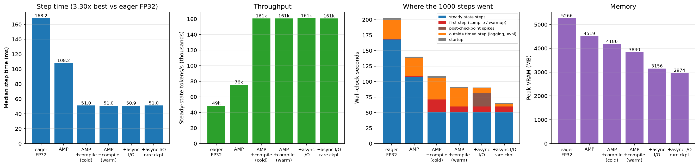

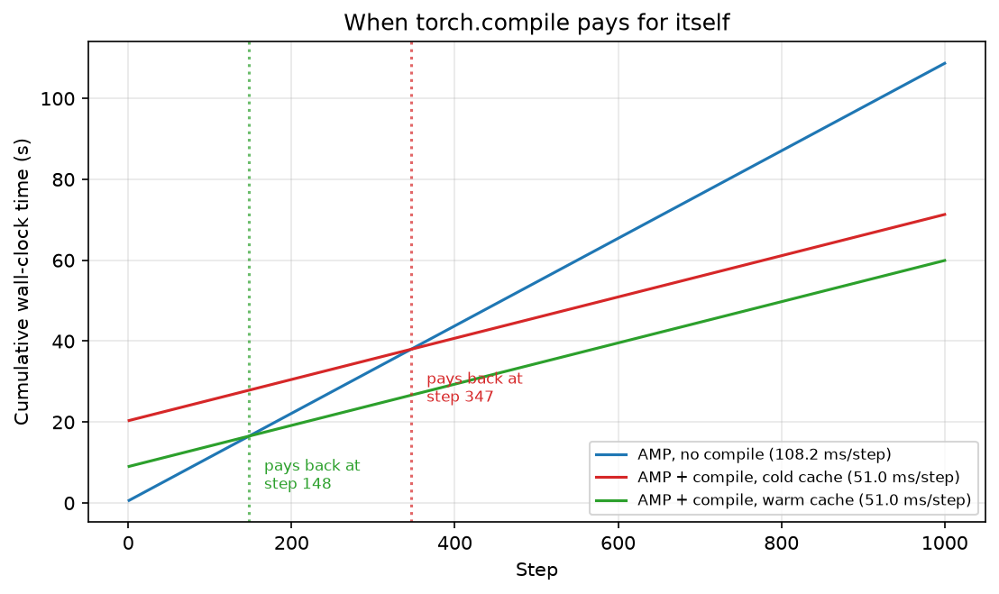

<!--
Lead with what is solid: median step time 168.2 -> 108.2 -> 51.0 ms, i.e. 1.56x
from mixed precision and a further 2.12x from compile, 3.30x cumulative, and peak
VRAM 5266 -> 4186 MB. Both mattered: AMP for memory headroom, compile for speed.
FP16 on Turing tensor cores is what makes the AMP step real rather than cosmetic.

Then the three things this staging was built to separate. All three came out
cleanly and two contradict the obvious reading:

  - Compile cost, cold versus warm cache. Identical steady step time (51.0 ms
    both), different first step: 20.4 s against 9.0 s. So 11.4 s of what looks
    like compile cost is cache population, and even the warm run pays 9 s of
    tracing and kernel selection that no cache can remove. An earlier version of
    this experiment let the async run silently inherit a warm cache and credited
    that saving to async I/O; the runs now set TORCHINDUCTOR_CACHE_DIR explicitly
    per stage. The payback figure gives the useful statement: compile saves
    ~57 ms/step over AMP, so it repays even a cold compile within a few hundred
    steps and is irrelevant at the scale of the long runs.

  - Async I/O alone is very nearly a wash, and this is the surprise. Against the
    warm-cache sync run it cuts time spent outside the timed step from 29.2 s to
    8.2 s (the synchronous per-step metrics.jsonl append, ~21 ms/step, i.e. 40% of
    a compiled step spent writing one JSON line) but adds 21.9 s back as nine
    step-time spikes. Net end-to-end: 92.2 s against 90.5 s, a 1.8% gain. Say
    explicitly that a change which looked like a 1.5x speedup before the cache was
    controlled is worth under two seconds on a 1000-step run.

  - The spikes are the checkpoint writer, now proven rather than hypothesised.
    Moving save_every from 100 to 1000 removes all nine spikes and 21.9 s with
    them, drops outside-step time further (8.2 -> 4.2 s), and takes the run to
    64.8 s: 30% faster than the sync baseline at identical step time. So the real
    lever was checkpoint frequency, and async I/O only pays once checkpoints are
    infrequent. Worth stating as the recommendation: buffer metrics, checkpoint
    rarely, and then the writer thread becomes a genuine win. Note the spikes are
    ~2.4 s each against a 51 ms step, so a single frequent checkpoint costs the
    equivalent of ~48 training steps.

Memory resolves cleanly too, including a drop that was unexplained in an earlier
draft. Reading the column bottom-up: 2974 MB is the true training peak (sys_05,
and it matches ts_batch_32 exactly), frequent async checkpointing adds 182 MB,
frequent synchronous checkpointing adds 866 MB, cold-cache compile autotuning adds
346 MB over the warm run, dropping compile costs 333 MB more, and FP32 costs a
further 747 MB. So the 4186 -> 3156 MB difference reported in an earlier draft was
the sync-versus-async checkpoint path plus autotuning, not a mystery.

Method note: every step is bracketed with torch.cuda.synchronize(), which slightly
suppresses absolute throughput but is constant across stages, so ratios hold. Worth
one sentence here, because it is unusually good evidence: this entire ladder was
measured twice, once under GPU contention and once idle. Absolute throughput moved
by 1.30x, but the speedup ratios reproduced to 1.1% and 0.05% (1.538 -> 1.555 for
AMP over FP32, 2.121 -> 2.122 for compile over AMP), and the qualitative
conclusions about async I/O and checkpoint frequency were identical in both. The
numbers reported here are the idle-GPU measurement; see section 9.
-->

### 4.3 Side effects on model quality

<!--
Short and important. Final validation loss across the six stages is 2.1595, 2.1614,
2.1604, 2.1603, 2.1601, 2.1607: a spread of 0.0019, which is exactly the +/-0.002
replicate floor from section 3, so the stages are statistically
indistinguishable. The 3.30x speedup and 44% memory reduction are free in
quality terms at this scale, and FP16 autocast with a gradient scaler produced no
degradation and no scaler-driven instability over 1000 steps. That last point is
not automatic on Turing, where bf16 is unavailable and FP16 range is genuinely
tight, so it is worth stating as a result rather than an assumption.

Two caveats, one line each: 1000 steps rules out an immediate penalty, not a
late-training divergence; and equal loss is not bitwise reproducibility, which is
why section 3 quotes a nondeterminism floor at all.

Close by handing off: every run in sections 5 onward uses this stack, with
checkpoints every 5000 steps rather than every 100, per 4.2.
-->

## 5. TinyStories

### 5.1 Learning Rate

| Run | Learning rate | Final validation loss | Status |
| --- | ---: | ---: | --- |
| `ts_lr_3e_4` | 3.0e-04 | 1.8346 | stable |
| `ts_lr_7e_4` | 7.0e-04 | 1.6701 | stable |
| `ts_lr_1p5e_3` | 1.5e-03 | 1.6157 | stable |
| `ts_lr_3e_3` | 3.0e-03 | 1.7463 | stable |
| `ts_lr_1e_2` | 1.0e-02 | 8.5963 | diverged |

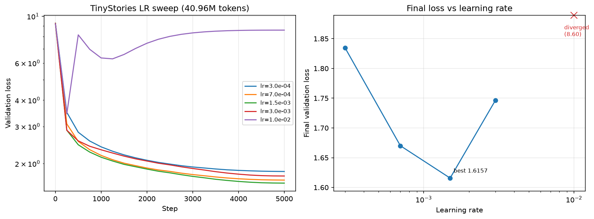

<!--
In this order:
  - Search strategy first, in one sentence: a logarithmic sweep across two orders
    of magnitude at a fixed 40.96M-token budget, then the best value carried into
    every later TinyStories run.
  - The U-shape and the optimum at 1.5e-3. The basin is shallow: 7e-4 and 3e-3 are
    within 0.13 of best, so the model is not LR-brittle inside the stable regime.
  - The instability edge, which is what the assignment asks about. 3e-3 still
    trains but is worse than 7e-4 despite being closer to the optimum in log
    space: the classic edge-of-stability signature, i.e. the best LR sits just
    below the divergence threshold. 1e-2 fails in a specific way worth describing:
    it improved during warmup (3.44 at step 250), blew up when the schedule reached
    full LR (8.16 at step 500), then settled at 8.596. ln(10000) = 9.21, so it
    collapsed to roughly a unigram predictor, and cosine annealing never recovered
    it. So divergence here is not a NaN but an absorbing state.
  - One sentence on reporting the final rather than the minimum, and why that
    matters for the diverged row.
-->

### 5.2 Batch Size

| Batch size | Steps | Tokens processed | Final validation loss | Tokens/s | Wall clock | Peak VRAM |
| ---: | ---: | ---: | ---: | ---: | ---: | ---: |
| 16 | 10000 | 40.96M | 1.5813 | 134,870 | 5.6 min | 1650 MB |
| 32 | 5000 | 40.96M | 1.6151 | 158,595 | 4.6 min | 2974 MB |
| 64 | 2500 | 40.96M | 1.6513 | 176,330 | 4.4 min | 5639 MB |

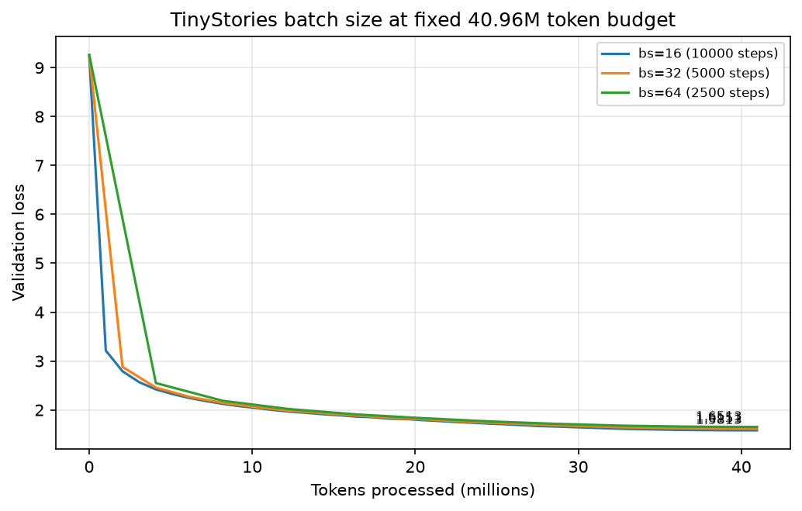

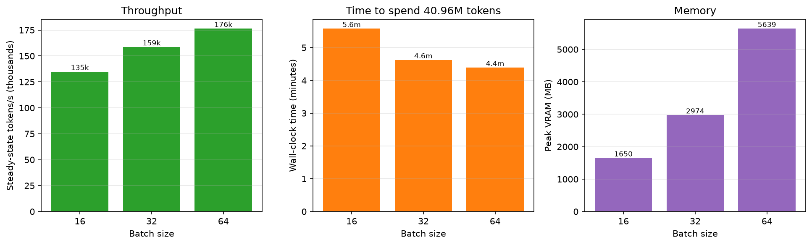

<!--
No winner, only a tradeoff, and say so:
  - At fixed tokens, smaller batch wins on loss (1.5813 vs 1.6513, ~350x the noise
    floor) because it buys 4x more optimizer updates from the same data.
  - Larger batch wins on hardware efficiency: 176k against 135k tokens/s, 4.4
    against 5.6 min. Step time grows sublinearly with batch (30.4 / 51.6 / 92.9 ms),
    which is the mechanism, and VRAM grows superlinearly (1650 / 2974 / 5639 MB),
    which is the constraint and ties back to section 4.
  - State the confound honestly and do not pretend to have bounded it: the LR was
    fixed at 1.5e-3, tuned at batch 32, so batch 16 and 64 are both slightly
    handicapped, and this experiment cannot separate "more updates help" from
    "this LR suits batch 32". Section 6.3 provides independent support for the
    update-count reading on a different dataset, which is the honest way to shore
    this up. Re-tuning the LR per batch is listed in section 9 as not done.
  - Land the practical conclusion: at a fixed token budget prefer more updates,
    and if you increase batch for throughput, expect to rescale the LR.
-->

### 5.3 Context Length

| Context | Batch size | Steps | Tokens/update | Final validation loss | Tokens/s | Peak VRAM |
| ---: | ---: | ---: | ---: | ---: | ---: | ---: |
| 128 | 64 | 5000 | 8192 | 1.7076 | 172,712 | 2718 MB |
| 256 | 32 | 5000 | 8192 | 1.6170 | 158,699 | 2974 MB |
| 512 | 16 | 5000 | 8192 | 1.5988 | 136,751 | 3487 MB |

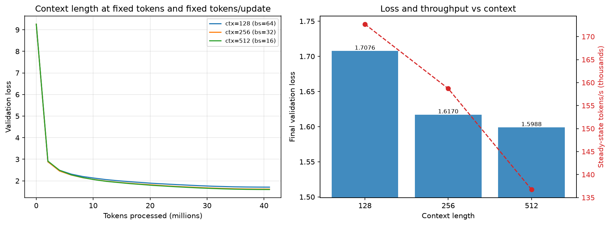

<!--
  - Explain the design first: batch moves inversely with context so both the token
    budget (40.96M) and the tokens per update (8192) stay fixed. Only then is the
    comparison about context.
  - Monotone improvement with diminishing returns: 128 -> 256 buys 0.091,
    256 -> 512 buys 0.018. TinyStories documents are short and simple, so there is
    little long-range structure left past a few hundred tokens. That is a dataset
    property, not a model property, and it should not be expected to transfer to
    OpenWebText.
  - Cost: 173k -> 137k tokens/s, as attention goes quadratic in sequence length
    while the FFN and the dominant softmax head stay linear.
  - Cross-sweep point worth making: ts_batch_16 (10000 updates of 4096 tokens)
    reached 1.5813, better than ts_ctx_512 (5000 updates of 8192 tokens) at 1.5988
    on the same 40.96M tokens. Update count and context length are separate levers,
    and update count is the stronger one at this budget.
-->

### 5.4 Full Run at the Recommended Configuration

| Metric | Value |
|---|---:|
| Run | `ts_final` |
| Configuration | bs 32, ctx 256, lr 1.5e-3, 40000 steps, 327.68M tokens |
| Validation loss | 1.3119 |
| Perplexity | 3.71 |
| Training time | 35.9 min |
| Steady-state tokens/s | 158,644 |
| Peak VRAM | 3345 MB |

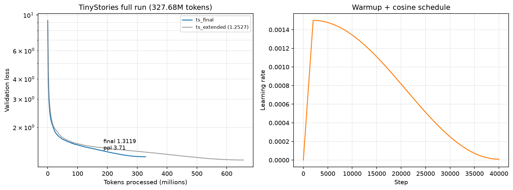

<!--
  - State explicitly that this is the assignment's recommended configuration
    (d_model 512, d_ff 1344, 4 layers, 16 heads, ctx 256, vocab 10k, rope 10000,
    327.68M tokens) with only the LR tuned, and that 1.3119 clears the required
    1.45 threshold with room to spare.
  - What the 8x budget increase over the sweep runs bought: 1.6157 -> 1.3119, i.e.
    0.30 nats. The curve is still descending at the budget limit, which is what
    motivates section 7. The figure overlays ts_extended so that is visible.
  - Right panel: warmup plus cosine reaching 1e-5. Note every run anneals fully
    (steps_for_cosine == num_steps), so no run is judged mid-decay.
  - Then the sample. Generate with the ts_extended checkpoint (the better model)
    and say which checkpoint you used:
      ./.venv_cluster/bin/python -m cs336_basics.decoding \
        --load_path checkpoints/ts_extended/checkpoint_080000.pt \
        --prompt "Once upon a time" --temp 0.8 --top_p 0.9
    Both samples below are already generated. What to say about them:

    The temperature 0.8 sample is strong evidence the model learned the domain:
    grammatical throughout, one consistent protagonist (Tim) carried across five
    paragraphs, a recognisable narrative arc (discovery -> intention -> resolution)
    and a genre-appropriate closing formula. It ran to the 256-token cap without
    emitting <|endoftext|>. The failures are semantic rather than syntactic and
    worth naming precisely: "it is a big, red ambulance. But it is very old and has
    an accident" is locally well-formed but incoherent, and "Tim was sad because he
    didn't know the ambulance was there" contradicts the preceding sentence. So the
    model has learned form and local plausibility, not world consistency.

    The temperature 1.2 / top-p 1.0 sample is the contrast, and it degrades
    progressively rather than all at once: the first two paragraphs are clean, then
    it produces non-words ("leging"), broken syntax ("The beautiful In the picture
    burned veryane and with everything he took came") and finally incoherence ("The
    bad ending came to pressure Lily lost her imagination escape the whole story").
    That is the mechanism to explain: raising temperature flattens the distribution
    and removing the top-p cut lets long-tail tokens through, and once one
    implausible token is committed the context itself is off-distribution, so errors
    compound.

    That gives you the two required factors with evidence: (1) decoding parameters,
    temperature and top-p; (2) training budget, which you can support from section 7
    rather than another generation, since ts_extended at 1.2527 is the better model.
    Optionally note that the run with --max_length 2048 terminated on its own with
    <|endoftext|> after ~107 words, which shows the model has learned story-length
    structure and not just local style.
-->

**`ts_extended`, prompt "Once upon a time", temperature 0.8, top-p 0.9, 256 tokens**

> Once upon a time, in a small town, there was a little boy named Tim. Tim loved to play with his toy cars and run around in the park. One day, while playing, Tim saw a big, red ambulance. He thought it was very interesting.
>
> Tim went to his friend, Sue. He asked her, "Sue, do you know what that big red ambulance is?" Sue said, "No, Tim, it is a big, red ambulance. But it is very old and has an accident."
>
> Tim was sad because he didn't know the ambulance was there. He wanted to be a helper when he grew up. So, Tim decided to be a good boy and help his friends when they needed him.
>
> One day, Tim saw a big truck with many people inside. He asked the man if he could help. The man smiled and said, "Sure, Tim. You can help me with this truck." Tim was very happy and knew he could be a helper.
>
> Tim's friends came over to see the big, red ambulance. They all helped the man get better. Tim was so proud of himself for being a good helper. He knew that being a good friend was the best thing he could be. And he lived happily ever after.

**Same checkpoint and prompt, temperature 1.2, top-p 1.0**

> Once upon a time, there was a wealthy man who lived in a big house. He loved to write. Every day, he wrote history with paper, oil, and sometimes even glue.
>
> One day, the wealthy man took his crayon and many nice words to write with. He was very excited to start writing. But then, his little sister, Lily, came to his wall. She wanted to draw too, but she didn't have the right spot. So, she took her clean crayon and started to wave it around the room.
>
> The wealthy man did not see his young sister in the room. He kept cleaning the wall. Suddenly, there was a big earthquake! The crayon was shaking and leging on Lily. She was very scared and cried for help. The beautiful In the picture burned veryane and with everything he took came. The wealthy man was sorry but the kids could not find their homes because of their small box of crayons. The bad ending came to pressure Lily lost her imagination escape the whole story.
>
> <|endoftext|>

## 6. OpenWebText

### 6.1 Learning-Rate Transfer

| Run | Learning rate | Final validation loss | Delta vs best |
| --- | ---: | ---: | ---: |
| 0.5x TinyStories LR | 7.50e-04 | 4.5221 | +0.0139 |
| 1.0x TinyStories LR | 1.50e-03 | 4.5082 | +0.0000 |
| 2.0x TinyStories LR | 3.00e-03 | 4.6445 | +0.1363 |

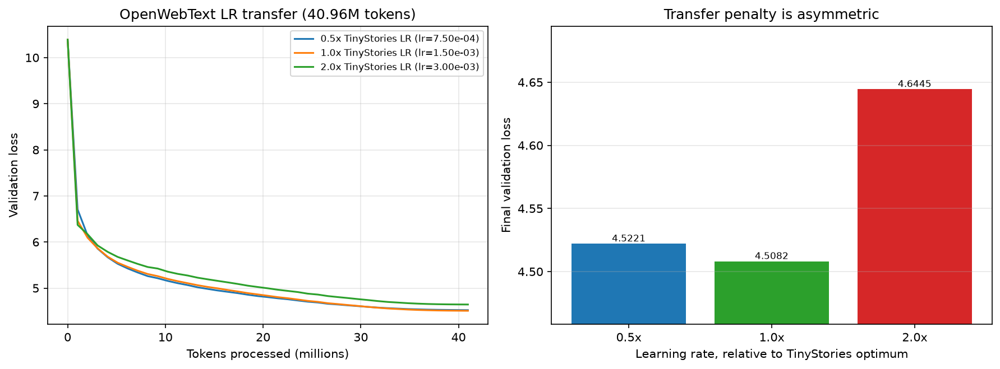

<!--
  - The TinyStories optimum appeared to transfer unchanged despite a 3.2x larger
    vocabulary, a halved batch and a completely different data distribution.
  - The asymmetry is the useful part: halving costs 0.014 (7x the noise floor, so
    real but small), doubling costs 0.136, ten times worse. Practical rule: when
    transferring an LR to a new dataset under a small budget, err low.
  - Then flag the methodological gap that 6.3 closes, because it is a fair
    criticism of this experiment: three points spanning one octave around a guess,
    with the lowest at 7.5e-4, does not bracket an optimum. Hand off; do not
    resolve it here.
-->

### 6.2 First Full Run

| Metric | Value |
|---|---:|
| Run | `owt_final` |
| Configuration | bs 16, ctx 256, lr 1.5e-3, 80000 steps, 327.68M tokens |
| Validation loss | 3.8692 |
| Perplexity | 47.90 |
| Training time | 74.5 min |
| Steady-state tokens/s | 76,924 |
| Peak VRAM | 4409 MB |

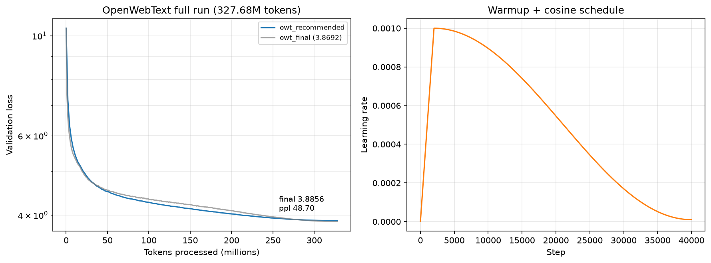

<!--
  - The comparison the assignment asks for: loss is 2.56 nats above TinyStories at
    identical architecture and token budget, and still descending at the limit.
    Interpret it: TinyStories is synthetic, small-vocabulary, template-like child
    stories with weak long-range dependence, so a 22.7M-parameter model fits it
    quickly. OpenWebText is real web text with far higher entropy, no template
    structure and much longer-range dependence, and 327.68M tokens is a small
    budget for it. Higher loss means a harder task, not a failed run. Note the two
    numbers are per-token losses over different vocabularies, so section 8's bits
    per byte is the fair comparison.
  - Explain the throughput gap, which is a finding rather than an accident. In the
    same session, 76.9k tokens/s against ts_final's 158.6k, yet per-step time is
    nearly identical (53.2 against 51.6 ms) while moving half the tokens per step.
    Two causes: batch 16 halves tokens per step without halving step time, and the
    32000-token vocabulary means embedding plus output projection is 32.8M of 45.2M
    parameters (72%) against 10.2M of 22.7M (45%) on TinyStories. At d_model 512
    with 4 layers the softmax head dominates FLOPs and activation memory, so
    vocabulary size is a first-order systems parameter here, not a detail. It also
    explains why the OpenWebText probes in 4.1 show the smallest speedup from the
    optimized stack: one big matmul in the head is already efficient in FP32.
  - Note the compliance gap 6.3 closes: the assignment asks for the same
    architecture and the same number of iterations as the TinyStories run, and this
    run is token-matched (327.68M) but runs 80000 steps against 40000.
  - The sample belongs here, generated with the owt_extended checkpoint and the OWT
    tokenizer:
      ./.venv_cluster/bin/python -m cs336_basics.decoding \
        --load_path checkpoints/owt_extended/checkpoint_080000.pt \
        --vocab_path ./data/owt_train_vocab_32000.json \
        --merges_path ./data/owt_train_merges_32000.json \
        --prompt "In today's article, we take a closer look at" --temp 0.8 --top_p 0.9
    The assignment asks why this text is worse than TinyStories at equal
    architecture and budget. The sample below makes the answer concrete, so use its
    specifics rather than generalities:
      - Surface form is genuinely good. It produces newspaper register, correctly
        punctuated and attributed quotations, plausible paragraph structure, and
        invented-but-plausible proper nouns ("Mayor Ed Stromzczuk"). Local
        statistics are exactly what 327.68M tokens is enough to learn.
      - Global structure fails in three identifiable ways: circular tautology ("the
        city will do the same for a new city council", "go forward and try to move
        forward"), a phrase-level repetition loop around "City Council" that recurs
        in nearly every sentence, and category errors that reveal no world model
        ("approved the city's one-year-old project and two-year-old girls",
        "Wimbledon's city council", a speaker named "Bong" who then becomes
        "Wimbledon").
      - The mechanism: TinyStories has one genre, a tiny vocabulary and short
        dependencies, so a 22.7M-parameter model can cover it. OpenWebText requires
        factual consistency, entity tracking and discourse structure over hundreds
        of tokens, and at 45.2M parameters and 655.36M tokens the model is both
        undertrained (section 7: a budget doubling still bought 0.12 nats) and
        under-capacity. Cite section 7 rather than asserting it.
      - Add one sentence on the context limit, since it is visible here: generation
        conditions on a 256-token sliding window, so beyond that the model cannot
        see its own opening, which contributes to the drift. The --max_length 2048
        run produced ~551 words and terminated with <|endoftext|>, i.e. it generated
        well past its context window, and the topic wandered further as it went.
-->

**`owt_extended`, prompt "The city council announced on Tuesday that", temperature 0.8, top-p 0.9, 256 tokens**

> The city council announced on Tuesday that the city will do the same for a new city council.
>
> “We’re going to go forward and try to move forward,” said Mayor Ed Stromzczuk. “We have to go forward and make sure we have the right schools, city council and the City Council.”
>
> As part of the agreement, Wimbledon’s city council approved the city’s one-year-old project and two-year-old girls.
>
> City council voted unanimously on the proposal Wednesday, citing a reduction of the number of additional teachers and the City Council’s vote for the City Council’s changes.
>
> Bong said the city council was formed to ensure that the public needs to provide their educational and community service to all students who receive the city council.
>
> “We have a strong community in place and we are committed to working together to ensure that all students will continue to get involved and have the opportunity to experience the community that they can receive,” said Wimbledon.
>
> “It’s clear that we have a right to make the city more flexible and transparent and accessible. This is the first step in achieving the city’s budget.”
>
> Mayor Ed Stromzczuk said the council also

### 6.3 Testing Whether the Learning Rate Was the Problem

| Run | Learning rate | Final validation loss | Status |
| --- | ---: | ---: | --- |
| `owt_wide_2p5e_4` | 2.50e-04 | 4.9075 | stable |
| `owt_wide_5e_4` | 5.00e-04 | 4.6528 | stable |
| `owt_wide_1e_3` | 1.00e-03 | 4.5140 | stable |
| `owt_wide_2e_3` | 2.00e-03 | 4.5532 | stable |

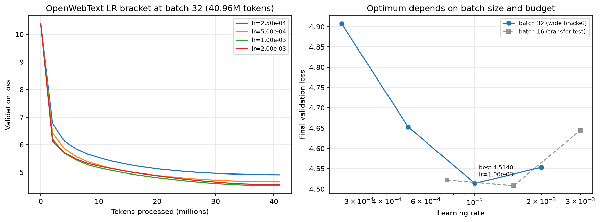

| Metric | `owt_final` | `owt_recommended` |
|---|---:|---:|
| Batch / steps | 16 / 80000 | 32 / 40000 |
| Learning rate | 1.5e-03 | 1.0e-03 |
| Optimizer updates | 80000 | 40000 |
| Validation loss | 3.8692 | 3.8856 |
| Perplexity | 47.90 | 48.70 |
| Peak VRAM | 4409 MB | 7405 MB |

<!--
Write this as a diagnosis that came back negative, which is more useful than a
patch that happened to work. Three moves:

1. The hypothesis and why it was plausible. Section 6.1 selected its LR from a
   three-point grid at 12.5% of the full budget whose lowest point was 7.5e-4, and
   short budgets are known to favour larger learning rates because they reward
   fast early progress. So the suspicion was that owt_final trained at an LR
   several times too high and that the sweep had simply never looked lower.

2. The test refutes it. The bracket at batch 32 puts the optimum at 1e-3 with both
   neighbours higher, and 2.5e-4 is the worst point by a wide margin (+0.39 against
   the best). Combined with the 6.1 points the basin is broad and flat from 7.5e-4
   to 2e-3: the two minima (4.5140 at bs32/1e-3 and 4.5082 at bs16/1.5e-3) differ
   by 0.006, about three times the noise floor. Conclusion: the learning rate was
   already effectively optimal, and there is no low-LR region hiding a better model.

3. The iteration-matched run confirms it and points at the real cause.
   owt_recommended (batch 32, 40000 steps, re-tuned lr 1e-3) reached 3.8856 against
   owt_final's 3.8692, i.e. marginally WORSE despite the retuning. The difference
   tracks optimizer updates rather than learning rate: 40000 against 80000 at an
   identical token budget, which is exactly the effect section 5.2 measured on
   TinyStories. Report this as an independent replication of the update-count
   finding on a second dataset and a second vocabulary; it is the strongest form
   the 5.2 claim takes in this report, precisely because nothing was tuned to make
   it come out that way.
   Then close the loop: if neither LR nor batch explains the gap to TinyStories,
   the remaining candidate is budget, which section 7 tests directly.
   Also note the memory cost this exposes: batch 32 at vocab 32000 peaks at 7405 MB
   against 4409 MB for batch 16, i.e. 66% of the card, which is the practical
   reason the OpenWebText runs used the smaller batch in the first place.
   One caveat: these two runs ran in different GPU-load conditions, so do not
   compare their wall clock; see section 9.
-->

## 7. Extended Budget

| Dataset | Run | Tokens | Val loss | Perplexity | Delta vs 327.68M |
|---|---|---:|---:|---:|---:|
| TinyStories | `ts_final` | 327.68M | 1.3119 | 3.71 | — |
| TinyStories | `ts_extended` | 655.36M | 1.2527 | 3.50 | −0.0592 |
| OpenWebText | `owt_recommended` | 327.68M | 3.8856 | 48.70 | — |
| OpenWebText | `owt_extended` | 655.36M | 3.7631 | 43.08 | −0.1225 |

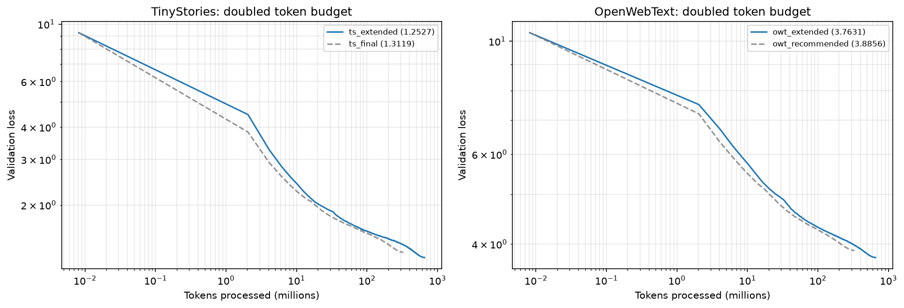

<!--
This section resolves section 6. Points to make:
  - Doubling the budget helps OpenWebText 2.07x more than TinyStories (0.1225
    against 0.0592 nats). Both models were undertrained at 327.68M tokens but
    OpenWebText far more so. That is the direct evidence for the 6.2 reading and it
    explains why no amount of LR tuning closed the gap in 6.3: the binding
    constraint was data, not hyperparameters.
  - Put the diminishing return in context: on TinyStories an 8x budget increase
    bought 0.30 nats (section 5.4) and this 2x bought 0.059, consistent with a
    roughly log-linear loss-versus-tokens relationship. Both extended curves are
    still descending at 655.36M tokens, so neither model is converged and the
    ranking of datasets would not change with more compute.
  - These are the report's best models: TinyStories 1.2527 (ppl 3.50) and
    OpenWebText 3.7631 (ppl 43.08).
  - Caveats, one line each: LR and warmup were rescaled to the new step count but
    not re-tuned for it, so a longer cosine at the same peak LR is itself a
    schedule change and not purely a budget change; and the wall-clock cost of the
    doubling is not quoted here because these runs and the 327.68M baselines ran
    under different GPU load (section 9). At equal throughput the cost is 2x.
-->

## 8. Final Comparison

| Dataset | Run | Vocabulary | Batch | Steps | Tokens | Val loss | Perplexity | Bits/byte | Peak VRAM |
| --- | --- | ---: | ---: | ---: | ---: | ---: | ---: | ---: | ---: |
| TinyStories | `ts_final` | 10000 | 32 | 40000 | 327.68M | 1.3119 | 3.71 | 0.459 | 3345 MB |
| TinyStories | `ts_extended` | 10000 | 32 | 80000 | 655.36M | 1.2527 | 3.50 | 0.439 | 3496 MB |
| OpenWebText | `owt_final` | 32000 | 16 | 80000 | 327.68M | 3.8692 | 47.90 | 1.278 | 4409 MB |
| OpenWebText | `owt_recommended` | 32000 | 32 | 40000 | 327.68M | 3.8856 | 48.70 | 1.284 | 7405 MB |
| OpenWebText | `owt_extended` | 32000 | 32 | 80000 | 655.36M | 3.7631 | 43.08 | 1.243 | 7403 MB |

| Tokenizer statistics (validation split) | Tokens | Bytes | Bytes/token |
|---|---:|---:|---:|
| TinyStories, vocab 10000 | 5,461,210 | 22,502,601 | 4.120 |
| OpenWebText, vocab 32000 | 66,401,098 | 289,998,753 | 4.367 |


<!--
One paragraph, built around the size of the correction, because it is larger than
you would guess. The two datasets use different tokenizers (10k against 32k), so
per-token cross-entropies are not comparable: a 32k tokenizer packs more bytes into
each token, which inflates per-token loss even at equal modelling quality. Bits per
byte normalizes by the text actually modelled:
    bpb = val_loss / ln(2) * tokens / bytes
The numbers to quote:
  - Best TinyStories model: 0.439 bpb. Best OpenWebText model: 1.243 bpb.
  - In perplexity the gap looks like 43.08 / 3.50 = 12.3x. In bits per byte it is
    1.243 / 0.439 = 2.83x. So perplexity overstates the difficulty gap by a factor
    of 4.3, almost entirely because the two tokenizers differ.
  - The two tokenizers are closer in compression than the vocabulary sizes suggest
    (4.120 against 4.367 bytes per token), so most of that 4.3x comes from the
    per-token loss scale rather than from packing.
Then state which comparisons are safe without the normalization (any two rows
within one dataset, since the tokenizer is held fixed) and which are not (any
TinyStories row against any OpenWebText row). The honest summary is that
OpenWebText is genuinely much harder, by roughly 2.8x in bits per byte, and that
the raw perplexity comparison in section 6.2 should be read as qualitative.
-->

## 9. Limitations

<!--
Specific and short, one bullet each, roughly ordered by how much each undermines a
conclusion.

  - GPU contention on a shared machine. Two other processes were resident on the
    card while four of the long runs were measured, costing ~1.30x in absolute
    throughput. Quantified by the one same-configuration pair that survives on
    disk: ts_final and ts_extended differ only in step count and ran at 158,644
    against 123,258 tokens/s, a factor of 1.287.
    How it was handled, and this is the part to state: sections 4.1 and 4.2 are the
    only places where absolute speed is the claim, and both were re-measured on an
    idle GPU, so the numbers reported there are clean. The runs still measured
    under contention are owt_wide_*, owt_recommended, ts_extended and owt_extended,
    and they are quoted for validation loss only. Losses are hardware-independent,
    so no conclusion in this report depends on the contention; and sections 7 and 8
    quote no wall-clock or throughput figures at all, so no cross-condition ratio
    can be read off them.
    Two residual imperfections worth admitting. The contended measurement of the
    4.2 ladder was overwritten by the idle re-measurement, so the observation that
    the speedup ratios were unchanged between the two conditions cannot be
    reproduced from the current repository state, only the idle numbers can. And
    the tokens/s columns in 5.2 and 5.3 come from a different idle session than the
    4.1 probes; they agree to within 2% at the shared configuration (158,595
    against 162,056 at batch 32), which is the order of run-to-run variation on
    this machine.
  - Single seed per configuration. The +/-0.002 spread is measured on one
    configuration and captures kernel and dataloader nondeterminism, not
    seed-to-seed variance in initialization or data order.
  - LR was not re-tuned inside the batch and context sweeps, so those results mix
    the swept variable with a possibly mistuned LR. Section 6.3 supports the
    update-count reading independently but does not eliminate the confound.
  - Sweeps ran at 12.5% of the full budget. Section 6.3 is a worked example of a
    short-budget procedure being insufficient, so treat every short-run ranking in
    this report as provisional.
  - The systems ladder is cumulative rather than factorial, so it cannot separate
    mixed precision from compile. The cold/warm cache split fixes a different
    confound inside it.
  - Feasibility probes are 200 steps, so they measure memory and throughput, not
    convergence, and they bracket the memory wall only as coarsely as the batch
    grid allows.
  - Validation batches are random spans, so they may overlap and are not a
    canonical held-out set; they also differ between runs at different context
    lengths.
  - Bits per byte depends on token and byte counts recorded once by hand.
  - Not attempted, and known to matter: weight tying (the untied head is 72% of
    OpenWebText parameters), the standard 0.02 embedding initialization in place of
    the unit-normal one used here, gradient accumulation, and a fused attention
    kernel. These are the obvious next steps and the reason the throughput numbers
    are not a hardware ceiling.
-->

## 10. Reproducibility

```text
All stages:        bash run_experiments.sh
Selected stages:   STAGES="feasibility systems" bash run_experiments.sh
Stage names:       STAGES=list bash run_experiments.sh
Single run:        ./.venv_cluster/bin/python -m cs336_basics.training_together --run_name <name> ...
Figures + tables:  uv run python scripts/make_plots.py [--tables]
Metrics layout:    checkpoints/<run_name>/{config.json,metrics.jsonl,summary.json}
Compile cache:     .inductor_cache/<cache_name>  (cold-cache runs delete theirs first)
Best TinyStories:  checkpoints/ts_extended   (1.2527, ppl 3.50)
Best OpenWebText:  checkpoints/owt_extended  (3.7631, ppl 43.08)
Assignment-matched: checkpoints/ts_final, checkpoints/owt_recommended
Hardware:          RTX 2080 Ti, 11264 MiB, driver 550.127.05, CUDA 12.4
Software:          PyTorch 2.6.0+cu124, Python 3.12
Seed:              42
```
